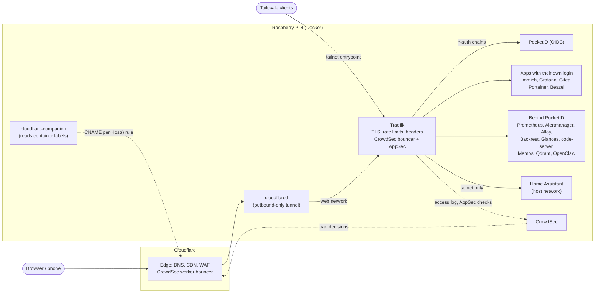

# homelab

My self-hosted Raspberry Pi setup, as code.

One Raspberry Pi runs about thirty containers behind a Cloudflare Tunnel and Traefik: identity, intrusion prevention, metrics, logs and alerting, backups, Home Assistant, photo storage, and a small local AI memory stack. Everything is Docker Compose: one directory per stack, secrets in gitignored `.env` files, and services published through Traefik labels alone.

This repository is a curated, sanitized public copy of my private config repo, with fresh history. Secrets, identifiers and personal apps are left out, and placeholders are documented in each stack's `.env.example`. See [What is not here](#what-is-not-here).

## Hardware

- Raspberry Pi 4 Model B, 8 GB RAM
- Boots from a 2 TB SSD over USB 3 (no SD card)
- Debian 13 (trixie), arm64

## Architecture



- **No port forwarding.** Internet traffic arrives only through the tunnel. A few ports are published on the host for LAN or tailnet use (Traefik's tailnet entrypoint, Gitea's SSH and web ports, Immich, Pocket ID), and Home Assistant and the Beszel agent use host networking. The ports only Home Assistant needs (Glances, Portainer) and CrowdSec's API and metrics are bound to `127.0.0.1`.
- **Every public router has a middleware chain** from [`conf.d/traefik_dynamic_default.yml`](stacks/traefik/conf.d/traefik_dynamic_default.yml): rate limiting, security headers and the CrowdSec bouncer, plus PocketID for `*-auth` chains. A priority-1 catch-all returns 503 for unknown hosts.
- **Two enforcement points for bans.** CrowdSec decisions are applied in Traefik and pushed to a Cloudflare Worker at the edge.
- **Home Assistant is not on the internet.** It is only routed on the `tailnet` entrypoint, behind an IP allowlist that reads the real socket peer rather than `X-Forwarded-For`.

More detail, including the monitoring pipeline and auth tiers: [docs/architecture.md](docs/architecture.md).

## Stacks

| Stack | What it runs |
|---|---|
| [traefik](stacks/traefik) | Reverse proxy with wildcard TLS via Cloudflare DNS-01, OIDC and CrowdSec plugins, and shared middleware chains; cloudflare-companion creates DNS records from router labels |
| [cloudflare-tunnel](stacks/cloudflare-tunnel) | `cloudflared`, the only ingress, plus `cf-api.sh` for scripted DNS and tunnel lookups |
| [crowdsec](stacks/crowdsec) | IPS engine reading Traefik's access log, AppSec WAF, Cloudflare Worker bouncer, hub-upgrade script |
| [pocket-id](stacks/pocket-id) | Passkey OIDC provider behind all `*-auth` chains |
| [monitoring](stacks/monitoring) | Alloy, Prometheus (alert and recording rules), Loki, Alertmanager, Grafana with provisioned dashboards, and the read-only Docker socket proxy |
| [backrest](stacks/backrest) | Scheduled restic backups of all stack data, with a `pg_dump` hook for Immich |
| [beszel](stacks/beszel) | Lightweight host and container monitoring, hub and agent |
| [glances](stacks/glances) | System monitor UI, also used by Home Assistant over loopback |
| [portainer](stacks/portainer) | Container management; feeds Home Assistant's container entities |
| [home-assistant](stacks/home-assistant) | HA Container on the host network, tailnet only, with a dashboard generated from live container data |
| [immich](stacks/immich) | Photo and video backup with ML limited to 1.5 CPU / 2 GB |
| [qdrant](stacks/qdrant) | Vector database for the agent's semantic memory, plus an idempotent collection init script |
| [embedding-service](stacks/embedding-service) | Local Flask + fastembed API (all-MiniLM-L6-v2, 384 dims) |
| [openclaw](stacks/openclaw) | AI agent gateway, the most hardened container (read-only rootfs, no capabilities) |
| [gitea](stacks/gitea) | Self-hosted Git |
| [memos](stacks/memos) | Notes, with strict session cookie settings |
| [code-server](stacks/code-server) | VS Code in the browser over the host's dev directory |

## How deployment works

Deployment is deliberately simple and manual. There is no deploy pipeline in this setup.

1. The config repo is cloned on the Pi. Each stack directory is its own Compose project.
2. The shared `web` network is declared `external` by the stacks that use it, so it has to exist before they start. The `monitoring` stack creates `grafana-monitoring` (where the socket proxy lives), so it goes up before the stacks that join that network.
3. A stack is started or updated from its directory:
   ```bash
   cp .env.example .env   # first time only, then fill in the values
   docker compose pull && docker compose up -d
   ```
4. Publishing a new service needs no DNS or proxy config: join `web`, add Traefik labels with an explicit ``Host(`name.lucask.dev`)`` rule and a middleware chain, and `up -d`. Traefik picks up the router through the socket proxy, and cloudflare-companion creates the proxied CNAME to the tunnel.

This repository adds CI: [`validate.yml`](.github/workflows/validate.yml) renders every `compose.yaml` with `docker compose config` using its `.env.example` (it fails if a compose file uses a variable the example does not document) and runs `yamllint`. Dependabot watches the GitHub Actions, the compose image tags and the embedding service's base image.

## What is automated

| Area | How |
|---|---|
| TLS | Traefik requests wildcard certificates for both zones with the Cloudflare DNS-01 challenge |
| DNS | cloudflare-companion creates one proxied CNAME per `Host()` rule it finds in container labels |
| Routing | Traefik discovers containers through the read-only socket proxy (`exposedByDefault: false`) |
| Intrusion prevention | CrowdSec parses the access log and inspects requests inline. Bans apply in Traefik and at Cloudflare's edge. `hub-upgrade.sh` refreshes rules and restarts the engine only when something changed |
| Backups | Backrest runs restic plans nightly (03:00 configs and data, 04:00 Immich after a `pg_dump`) and keeps the last 14 snapshots |
| Metrics and logs | Alloy collects host, container, Traefik, CrowdSec and Home Assistant metrics, plus Docker and journald logs |
| Alerting | Prometheus rules go to Alertmanager, then to a Home Assistant webhook, which sends a push to the phone |
| Log rotation | Traefik's entrypoint script rotates its own log files (10 MB, 3 kept) |
| Dashboards | Grafana datasources and dashboards are provisioned from files. The Home Assistant dashboard is generated by a script from the live container list |

## Conventions

- **One directory per stack** under `stacks/`, with `compose.yaml`, an `.env.example` when the stack needs variables, and a short README.
- **Secrets never in compose files.** They come from gitignored `.env` files through `${VAR}`, or from gitignored files read by the service (`credentials_file` in Alloy, `url_file` in Alertmanager, the bouncer middleware in `conf.d`).
- **Networks:** `web` (external) for anything Traefik routes to; `grafana-monitoring` for the socket proxy and metrics scraping; private per-stack networks for databases (`immich`, `gitea`).
- **Hostnames:** routers declare an explicit `Host()` rule on `lucask.dev`, so the DNS record follows automatically. A few older stacks (Backrest, Glances, Gitea) still rely on Traefik's `defaultRule`, which cloudflare-companion cannot see.
- **Volumes:** bind mounts inside the stack directory for data worth backing up (Backrest sees the whole `stacks/` tree). Named volumes for rebuildable data (Prometheus, Loki, model caches). Config files are mounted `:ro`.
- **Hardening where it fits:** `no-new-privileges` on many services, `cap_drop: ALL` and resource limits on the newer ones, and a `read_only` root filesystem for OpenClaw. Traefik, CrowdSec, Glances, cloudflare-companion and Alloy's container discovery use the read-only socket proxy. Portainer, Backrest (for hooks), Beszel's agent and Alloy's cAdvisor exporter still use the socket directly.
- **Pinned where upgrades bite:** Home Assistant, Alloy, Loki, Gitea, Qdrant and cloudflare-companion are pinned by tag, and Immich's Postgres and Valkey by digest. Other images track `latest` or a moving tag.

## Lessons learned and trade-offs

These come from comments and history in the configs.

- **Wildcard DNS was expensive.** With `*.lucask.dev` resolving, every scanner probe of a made-up subdomain went through the CrowdSec Worker, which costs one Workers KV read (100k/day on the free tier). Per-hostname CNAMEs, created automatically, mean unknown names return NXDOMAIN.
- **The alerter needs watching too.** Alertmanager had no restart policy, a Docker restart left it stopped, and nothing alerted for 3.5 months. It now has `restart: unless-stopped`. Prometheus still does not scrape it, so this remains a blind spot.
- **Fail-open over fail-closed.** The CrowdSec bouncer lets traffic through when AppSec is unreachable, so a CrowdSec restart does not take every site down. To compensate, `CrowdSecAppSecNotInspecting` fires when services get traffic but AppSec inspects nothing.
- **A Pi 4 has a CPU budget.** The full OWASP CRS is installed but not loaded (Cloudflare's managed WAF covers generic patterns upstream), and cAdvisor's per-container disk metrics were disabled after a profile showed them at about 35% of Alloy's CPU.
- **Go memory limits look like leaks.** Alloy and Grafana keep RSS just under their cgroup limit by design (GOMEMLIMIT), so they are excluded from the memory-near-limit alert. `ContainerOOMKilled` is the signal that matters.
- **Boot order can take everything down.** Binding Traefik's tailnet port to the Tailscale IP fails if `tailscale0` is not up yet, which would stop Traefik and every site with it. The port binds `0.0.0.0` and an IP allowlist enforces access.
- **`git pull` does not reach single-file bind mounts.** Git replaces a changed file with a new inode, so a mounted `prometheus.yml` or `config.alloy` keeps showing the old content and a reload re-reads it. Restart the container instead.
- **Proxies cut idle streams.** The socket proxy's 10-minute server timeout cut idle `docker logs --follow` streams. Alloy re-sent the last line on reconnect and Loki rejected it as too old, so log streams now get a 24h timeout.
- **Buffering breaks streaming.** The buffering middleware broke WebSockets, SSE and Traefik's own dashboard, and a `retryExpression` turned bodyless redirects into 500s. The request-size (buffering) middlewares are still defined but are not part of any chain, and streaming apps have their own `*-ws` / `*-sse` chains.
- **Upstream drift.** cloudflare-companion 7.4.0 stopped seeing new containers on current Docker API versions, so it is pinned and runs a patched script.
- **Known gaps.** Backups go to restic repositories on the same SSD, so they protect against mistakes and bad upgrades but not against losing the disk. Named volumes are not backed up. Cloudflare access uses the global API key; a scoped token would be tighter.

## Related projects

- [xD33m/gh-release-notifier](https://github.com/xD33m/gh-release-notifier): GitHub release notifications via Telegram or Discord. It runs on this Pi and is a git submodule of the private config repo.
- [xD33m/imax-seats](https://github.com/xD33m/imax-seats) and [xD33m/westwing-notif](https://github.com/xD33m/westwing-notif): other small self-hosted watchers of mine with their own Docker Compose setups.

## What is not here

Left out on purpose: `.env` files, certificates, `acme.json`, databases and volume data; CrowdSec credentials and the bouncer config; the Alloy token and Alertmanager webhook files; Home Assistant's `config/`; upstream files I patched (the cloudflare-companion script and the socket proxy's HAProxy template); a Home Assistant Grafana dashboard; and personal apps, games, remote-control tooling and retired stacks. Real domains other than `lucask.dev`, IPs, ids and emails are replaced with placeholders.

## License

[MIT](LICENSE)
