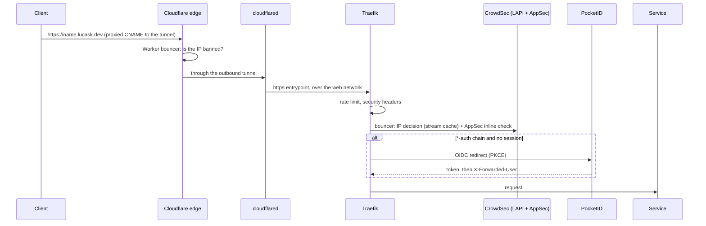
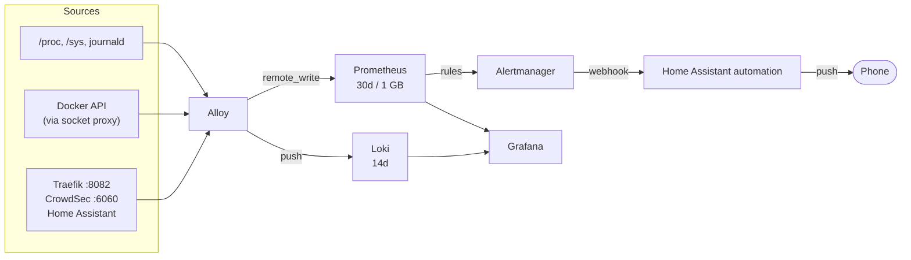

# Architecture

How requests reach a service, how they are authenticated, and how the Pi watches itself. File references are relative to the repository root.

## Request path

Unknown hostnames normally fail before this: DNS has no wildcard, so a name without a router gets NXDOMAIN. Anything that still arrives for an unknown host hits the priority-1 `catchall` router and gets a 503 with no middleware work.

Tailscale clients take a different path. They connect straight to the host's TCP 443, which maps to Traefik's `tailnet` entrypoint (`:8443`). Routers opt in to that entrypoint explicitly. Its `tailnet-only` allowlist checks the real socket peer against Tailscale's CGNAT and ULA ranges, and `forwardedHeaders` are deliberately not trusted there. Home Assistant is the service routed this way (`stacks/traefik/conf.d/home-assistant.yml`).

## Auth tiers

| Tier | Chain(s) | Used by |
|---|---|---|
| Public, app handles login | `secured`, `secured-upload`, `secured-ws`, `secured-relaxed`, `secured-relaxed-sse` | Grafana, Immich, Gitea, Portainer, Pocket ID, Beszel |
| PocketID OIDC in front | `secured-auth`, `secured-relaxed-auth`, `secured-auth-strict-ws` | Prometheus, Alertmanager, Alloy, Backrest, Glances, Memos, Qdrant, OpenClaw, code-server, the Traefik dashboard |
| Tailnet only | `tailnet-secured`, `tailnet-relaxed` | Home Assistant |
| Not routed | `traefik.enable=false` or no labels | embedding-service, Loki, docker-socket-proxy, CrowdSec |

The chains are defined in `stacks/traefik/conf.d/traefik_dynamic_default.yml`. Relaxed variants drop the strict CSP and Permissions-Policy for apps that need iframes, popups or browser APIs.

## Networks

| Network | Created by | Purpose |
|---|---|---|
| `web` | by hand, external everywhere | Everything Traefik routes to, plus the tunnel |
| `grafana-monitoring` | `stacks/monitoring` | Socket proxy, metrics scraping, Traefik and CrowdSec metrics endpoints |
| `immich` | `stacks/immich` | Immich's Postgres, Valkey and ML. Not reachable from Traefik |
| `gitea` | `stacks/gitea` | Stack-internal |
| host | - | Home Assistant (discovery, Bluetooth) and the Beszel agent |

Home Assistant reaches back into Docker through `172.18.0.1`, the host's address on the `web` bridge. Traefik routes to HA there, Alloy scrapes HA's `/api/prometheus` there, and Alertmanager posts to HA's webhook there. HA's own trusted-proxies setting is the `web` subnet.

## Observability pipeline

- Alloy replaces node-exporter, cAdvisor and Promtail with one process. Its config is `stacks/monitoring/alloy/config.alloy`.
- Prometheus scrapes only itself. Everything else is pushed by Alloy, and Prometheus has `--web.enable-remote-write-receiver` set.
- Recording rules (`prometheus/recording-rules.yml`) pre-compute the dashboard queries. Alert rules (`prometheus/rules.yml`) cover host resources, containers, Traefik, TLS expiry, the stack itself, and CrowdSec health.
- Alertmanager groups by alert name and severity. Critical alerts are sent after 30 s instead of 5 min. A critical alert suppresses the matching warning, and `ServiceDown` suppresses the other alerts for the same job.

## Defense layers

1. Cloudflare edge: DDoS protection, managed WAF, and the CrowdSec Worker bouncer.
2. Cloudflare Tunnel: no inbound port forwarding.
3. Traefik middlewares: rate limits per chain, HSTS, a strict CSP by default, and TLS 1.3 as the default TLS option.
4. CrowdSec in Traefik: IP decisions plus AppSec virtual patching and generic rules, inline. It fails open, and an alert fires if AppSec stops inspecting.
5. PocketID for anything administrative.
6. Container hardening where applied: `no-new-privileges`, dropped capabilities, resource limits, read-only root filesystems, and Docker API access through a `POST=0` proxy.

## Storage and backups

- Data that matters lives in bind mounts inside each stack directory, so Backrest, which mounts the whole `stacks/` tree, can reach it.
- Backrest plans (see `stacks/backrest/config/config.json.example`) run nightly. Immich's library goes to a separate restic repository after a `pg_dump` hook.
- Named volumes (Prometheus, Loki, Alertmanager, Alloy WAL, Portainer, the model caches) are outside the backup scope.
- Both restic repositories are on the Pi's own SSD. The configs have no off-site copy.
